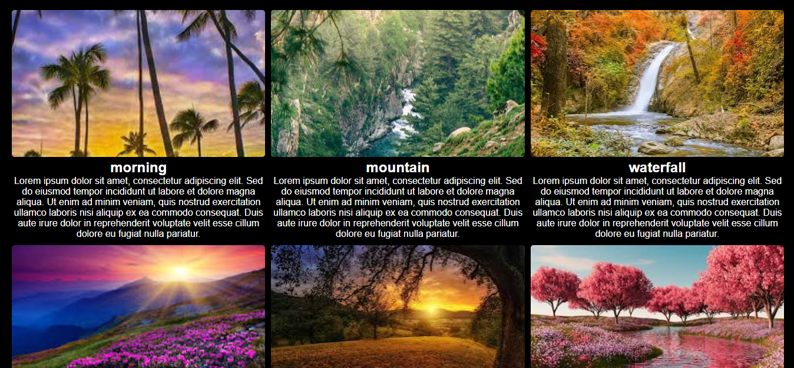

# 🖼️ React Dynamic Image Gallery

A simple and responsive image gallery built using React.js. This project displays a collection of images with their titles and descriptions in an organised grid layout.

## 🌐 Live Demo

[](https://dynamic-image-gallery-one.vercel.app/)

## 📸 Screenshot

<p align="center">
  
</p>

## ✨ Features

- 🖼️ **Image Gallery:** Displays a collection of images in an organised layout.
- 📝 **Image Details:** Shows titles and descriptions for each image.
- 📐 **Grid Layout:** Arranges images in a structured grid.
- 📱 **Responsive Design:** Adapts the gallery layout to different screen sizes.
- ⚛️ **React Components:** Uses React to structure and display gallery content.
- 🎨 **Custom Styling:** Uses CSS to style the gallery and its elements.

## 🛠️ Technologies Used

- ⚛️ React.js
- 📜 JavaScript
- 🌐 HTML5
- 🎨 CSS3
- ▲ Vercel

## 🚀 Run Locally

1. Clone the repository:

   ```bash
   git clone https://github.com/inthusha20241647-commits/dynamic-image-gallery.git
   ```

2. Navigate to the project directory:

   ```bash
   cd dynamic-image-gallery
   ```

3. Install dependencies:

   ```bash
   npm install
   ```

4. Start the development server:

   ```bash
   npm start
   ```

5. Open your browser at `http://localhost:3000`.

## 🎯 Learning Objectives

- Practise building a React application.
- Understand component-based development.
- Display collections of images using React.
- Organise content using a structured grid layout.
- Improve CSS styling and responsive design skills.

---

*This project is part of my continuous learning journey in React and frontend development.*
